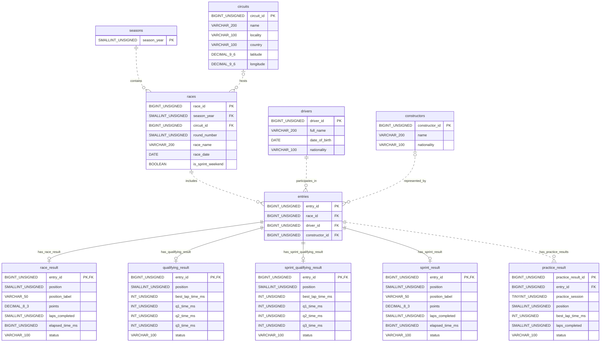

# Relational Model

**Status: preliminary proposal, awaiting owner review and approval.**

This document proposes a logical model for F1 Historical Database. It does not
create tables, supply historical records, or authorize SQL implementation. All
attributes, data types, keys, nullability, cardinalities, and constraints below
are proposals unless explicitly identified as confirmed requirements.

## Confirmed requirements

- Use exactly these 11 entities: `seasons`, `drivers`, `constructors`, `circuits`,
  `races`, `entries`, `race_result`, `qualifying_result`,
  `sprint_qualifying_result`, `sprint_result`, and `practice_result`.
- Use English names and snake_case identifiers.
- Connect drivers, constructors, and races through `entries`; a driver does not
  belong permanently to a constructor.
- Support one practice result per driver and practice session within a race
  weekend, allowing FP1, FP2, and FP3.
- Support optional sprint weekends and missing historical session data.
- Keep this work limited to editable design documentation pending approval.

## Diagram and synchronization

[`er_diagram.mmd`](er_diagram.mmd) is the source of truth for the diagram. The
Mermaid block below must remain identical to that file, including comments.
When the model changes, edit the `.mmd` file first, copy its full contents into
this block, and update the attribute and constraint descriptions together.

Mermaid type tokens such as `BIGINT_UNSIGNED`, `VARCHAR_200`, and `DECIMAL_8_3`
are display notation for `BIGINT UNSIGNED`, `VARCHAR(200)`, and `DECIMAL(8,3)`;
they are not executable SQL. The tables below specify exact proposed types and
nullability. `PK, FK` marks an attribute that serves both roles. Composite
uniqueness constraints are listed separately rather than marking their individual
columns as independently unique.

Solid lines indicate identifying relationships: each of the four single-session
result tables shares its primary key with `entries`. Dotted lines indicate
non-identifying relationships. End markers express minimum and maximum
cardinality independently of line style.

## Attribute conventions

- `Required` means a proposed non-null value; primary keys are always required.
- Numeric surrogate IDs are positive, application-independent identifiers. Their
  generation strategy is deferred; source/API identifiers are not assumed to be
  these keys. No identifiers or records are assigned in this proposal.
- `NULL` means unknown or unavailable, or not applicable where stated. It does
  not mean zero, an empty string, or a fabricated default.
- Durations are integer milliseconds, not times of day. Precision and source
  conversion rules require review. Dates use `DATE`; no start time or timezone
  is inferred.
- Text lengths and numeric widths are provisional. Names, nationality, status,
  and position labels retain supplied descriptions; controlled vocabularies and
  source mappings are deferred.

## Entities and attributes

### seasons

One championship season. Using the year as the natural primary key is a proposal
that assumes a single championship scope.

| Attribute | Proposed type | Required | Key / meaning |
| --- | --- | --- | --- |
| `season_year` | `SMALLINT UNSIGNED` | Yes | PK; positive season year |

### drivers

A driver identity independent of constructor affiliation and race participation.

| Attribute | Proposed type | Required | Key / meaning |
| --- | --- | --- | --- |
| `driver_id` | `BIGINT UNSIGNED` | Yes | PK |
| `full_name` | `VARCHAR(200)` | Yes | Display name; not a unique identifier |
| `date_of_birth` | `DATE` | No | Date if known |
| `nationality` | `VARCHAR(100)` | No | Source description if known |

### constructors

A constructor identity referenced by weekend entries. Continuity across name or
ownership changes needs a separate identity policy before implementation.

| Attribute | Proposed type | Required | Key / meaning |
| --- | --- | --- | --- |
| `constructor_id` | `BIGINT UNSIGNED` | Yes | PK |
| `name` | `VARCHAR(200)` | Yes | Display name; not unique |
| `nationality` | `VARCHAR(100)` | No | Source description if known |

### circuits

A venue identity. Separate circuit layouts or historical venue versions are not
represented by an additional entity in this preliminary model.

| Attribute | Proposed type | Required | Key / meaning |
| --- | --- | --- | --- |
| `circuit_id` | `BIGINT UNSIGNED` | Yes | PK |
| `name` | `VARCHAR(200)` | Yes | Display name; not unique |
| `locality` | `VARCHAR(100)` | No | Location description |
| `country` | `VARCHAR(100)` | No | Country description |
| `latitude` | `DECIMAL(9,6)` | No | Coordinate in degrees |
| `longitude` | `DECIMAL(9,6)` | No | Coordinate in degrees |

### races

One championship round/weekend, grouping its sessions. This is a proposal for
the meaning of `races`, rather than a requirement that every stored round has
completed a race or has complete session data.

| Attribute | Proposed type | Required | Key / meaning |
| --- | --- | --- | --- |
| `race_id` | `BIGINT UNSIGNED` | Yes | PK |
| `season_year` | `SMALLINT UNSIGNED` | Yes | FK -> `seasons.season_year` |
| `circuit_id` | `BIGINT UNSIGNED` | No | FK -> `circuits.circuit_id`; unknown venue allowed |
| `round_number` | `SMALLINT UNSIGNED` | Yes | Positive championship round number |
| `race_name` | `VARCHAR(200)` | Yes | Event description |
| `race_date` | `DATE` | No | Main race date if supplied |
| `is_sprint_weekend` | `BOOLEAN` | No | True: known sprint weekend; false: known non-sprint weekend; NULL: unknown |

Proposed alternate key: `UNIQUE (season_year, round_number)`. The scope excludes
multiple versions of the same round until a revision policy is approved.

### entries

One driver's participation in a race weekend. This includes a driver who only
participates in practice; it is not proof that the driver started the race.
Constructor affiliation belongs here, never on `drivers`.

| Attribute | Proposed type | Required | Key / meaning |
| --- | --- | --- | --- |
| `entry_id` | `BIGINT UNSIGNED` | Yes | PK |
| `race_id` | `BIGINT UNSIGNED` | Yes | FK -> `races.race_id` |
| `driver_id` | `BIGINT UNSIGNED` | Yes | FK -> `drivers.driver_id` |
| `constructor_id` | `BIGINT UNSIGNED` | No | FK -> `constructors.constructor_id`; unknown attribution allowed |

Proposed alternate key: `UNIQUE (race_id, driver_id)`. One constructor per driver
per weekend is an assumption requiring approval. Different weekends may reference
different constructors. Session-specific constructor changes and shared-car
attribution are unresolved; see [design decisions](design_decisions.md).

### race_result

At most one stored main race classification per entry. An entry can exist without
this row; a result row can exist with incomplete metrics.

| Attribute | Proposed type | Required | Key / meaning |
| --- | --- | --- | --- |
| `entry_id` | `BIGINT UNSIGNED` | Yes | PK and FK -> `entries.entry_id` |
| `position` | `SMALLINT UNSIGNED` | No | Positive numeric classification, if supplied |
| `position_label` | `VARCHAR(50)` | No | Original nonnumeric or textual classification label |
| `points` | `DECIMAL(8,3)` | No | Supplied points; signed, precision provisional |
| `laps_completed` | `SMALLINT UNSIGNED` | No | Nonnegative supplied lap count |
| `elapsed_time_ms` | `BIGINT UNSIGNED` | No | Supplied total elapsed duration, not a gap to another driver |
| `status` | `VARCHAR(100)` | No | Supplied result/participation status |

### qualifying_result

Proposed meaning: the qualifying classification for the main race. Mapping source
session names and formats to this entity requires approval.

| Attribute | Proposed type | Required | Key / meaning |
| --- | --- | --- | --- |
| `entry_id` | `BIGINT UNSIGNED` | Yes | PK and FK -> `entries.entry_id` |
| `position` | `SMALLINT UNSIGNED` | No | Positive numeric session classification |
| `best_lap_time_ms` | `INT UNSIGNED` | No | Session best lap, only when explicitly supplied or unambiguously defined |
| `q1_time_ms` | `INT UNSIGNED` | No | Supplied first qualifying-segment time |
| `q2_time_ms` | `INT UNSIGNED` | No | Supplied second qualifying-segment time |
| `q3_time_ms` | `INT UNSIGNED` | No | Supplied third qualifying-segment time |
| `status` | `VARCHAR(100)` | No | Supplied session status |

Segment fields do not require every format to have three segments. Do not derive
the classification or best lap automatically from these fields; their semantics
and source mapping need review. Additional session formats remain unresolved.

### sprint_qualifying_result

Proposed meaning: the qualifying classification for the sprint. The name alone
does not resolve historical session terminology; mapping remains unapproved.

| Attribute | Proposed type | Required | Key / meaning |
| --- | --- | --- | --- |
| `entry_id` | `BIGINT UNSIGNED` | Yes | PK and FK -> `entries.entry_id` |
| `position` | `SMALLINT UNSIGNED` | No | Positive numeric session classification |
| `best_lap_time_ms` | `INT UNSIGNED` | No | Session best lap under an approved source definition |
| `q1_time_ms` | `INT UNSIGNED` | No | Supplied first qualifying-segment time |
| `q2_time_ms` | `INT UNSIGNED` | No | Supplied second qualifying-segment time |
| `q3_time_ms` | `INT UNSIGNED` | No | Supplied third qualifying-segment time |
| `status` | `VARCHAR(100)` | No | Supplied session status |

All segment-format cautions for `qualifying_result` also apply here.

### sprint_result

At most one stored sprint classification per entry. No entry is required to have
one, including entries at known sprint weekends.

| Attribute | Proposed type | Required | Key / meaning |
| --- | --- | --- | --- |
| `entry_id` | `BIGINT UNSIGNED` | Yes | PK and FK -> `entries.entry_id` |
| `position` | `SMALLINT UNSIGNED` | No | Positive numeric classification, if supplied |
| `position_label` | `VARCHAR(50)` | No | Original nonnumeric or textual classification label |
| `points` | `DECIMAL(8,3)` | No | Supplied points; signed, precision provisional |
| `laps_completed` | `SMALLINT UNSIGNED` | No | Nonnegative supplied lap count |
| `elapsed_time_ms` | `BIGINT UNSIGNED` | No | Supplied total elapsed duration, not a gap |
| `status` | `VARCHAR(100)` | No | Supplied result/participation status |

### practice_result

One stored classification per entry and practice session. Under the proposed
entry uniqueness rule, this is one row per race, driver, and practice session.

| Attribute | Proposed type | Required | Key / meaning |
| --- | --- | --- | --- |
| `practice_result_id` | `BIGINT UNSIGNED` | Yes | PK |
| `entry_id` | `BIGINT UNSIGNED` | Yes | FK -> `entries.entry_id` |
| `practice_session` | `TINYINT UNSIGNED` | Yes | 1 = FP1, 2 = FP2, 3 = FP3 |
| `position` | `SMALLINT UNSIGNED` | No | Positive numeric session classification |
| `best_lap_time_ms` | `INT UNSIGNED` | No | Supplied session best lap |
| `laps_completed` | `SMALLINT UNSIGNED` | No | Nonnegative supplied lap count |
| `status` | `VARCHAR(100)` | No | Supplied session status |

Proposed alternate key: `UNIQUE (entry_id, practice_session)`. No weekend is
required to have all three sessions or a record for every driver in each session.

## Relationships and cardinalities

The diagram contains exactly the 11 required entities and these 10 relationships.
Each referenced parent can exist without child records, supporting partial data.

| Parent -> child | Children per parent | Parent per child | Meaning |
| --- | --- | --- | --- |
| `seasons` -> `races` | 0..N | Exactly 1 | A season can be registered before its rounds |
| `circuits` -> `races` | 0..N | 0..1 | A race's venue may be unknown |
| `races` -> `entries` | 0..N | Exactly 1 | A weekend can have no imported participants yet |
| `drivers` -> `entries` | 0..N | Exactly 1 | Participation connects a driver to each weekend |
| `constructors` -> `entries` | 0..N | 0..1 | Constructor attribution is per entry and may be unknown |
| `entries` -> `race_result` | 0..1 | Exactly 1 | Optional one-to-one result extension |
| `entries` -> `qualifying_result` | 0..1 | Exactly 1 | Optional one-to-one result extension |
| `entries` -> `sprint_qualifying_result` | 0..1 | Exactly 1 | Optional one-to-one result extension |
| `entries` -> `sprint_result` | 0..1 | Exactly 1 | Optional one-to-one result extension |
| `entries` -> `practice_result` | 0..3 | Exactly 1 | Mermaid shows 0..N; session-domain and UNIQUE rules bound it to three |

These are maximum 1:N and optional 1:1 relationships, not requirements for
complete participation. No result repeats `race_id`, `driver_id`, or
`constructor_id`: these are obtained through its entry, avoiding contradictory
attribution. No direct permanent driver-constructor relationship is proposed.

## Proposed constraints

### Keys and uniqueness

| Entity / scope | Proposed constraint |
| --- | --- |
| Every entity | PK on the attribute marked PK; positive numeric values |
| `races` | `UNIQUE (season_year, round_number)` |
| `entries` | `UNIQUE (race_id, driver_id)` |
| `race_result`, `qualifying_result`, `sprint_qualifying_result`, `sprint_result` | PK/FK `entry_id` enforces at most one row of each type per entry |
| `practice_result` | `UNIQUE (entry_id, practice_session)` in addition to its surrogate PK |

Names, dates, nationality, result positions, points, and lap times are not unique.
There is no uniqueness constraint on `(race_id, constructor_id)`: multiple drivers
can represent a constructor. No racing number is used as a permanent driver key.

### Row-local validation

- `season_year`, `round_number`, and numeric identifiers must be positive. No
  current-year limit is assumed.
- `practice_session` must be one of `1`, `2`, `3`; it cannot be NULL.
- A known numeric `position` must be positive. Unknown or textual-only
  classifications keep the numeric value NULL; position uniqueness is not assumed.
- Known `laps_completed` and `elapsed_time_ms` must be nonnegative; known lap
  and qualifying-segment times must be positive. Missing times remain NULL rather
  than zero. Unsigned types express part of this proposed domain.
- Known latitude must be between -90 and 90; known longitude between -180 and
  180. Either may remain unknown.
- `is_sprint_weekend` permits only true, false, or NULL. Its intended logical
  domain must be enforced explicitly if the eventual physical type permits other
  numeric values; an omitted value must not default to false.
- `points` has no proposed nonnegative restriction or default. Signed values and
  three decimal places require approval against future source requirements.
- Required names/descriptions must contain non-whitespace text. Nullable text
  should use NULL for unavailable values, not empty placeholders.

These are logical constraint proposals, not SQL statements. Any later
implementation must intentionally permit NULL on optional checks and validate
the behavior against the chosen database version.

### Referential and cross-entity validation

- Every non-null FK must reference an existing parent. Unknown constructor or
  venue attribution uses a nullable FK, never an invented parent record. Race
  and driver identity are mandatory for an entry; unresolved identities must be
  resolved or held outside the authoritative model during a future import.
- Propose restrictive deletion and key updates for referenced parents, with no
  automatic cascade. IDs should be stable. Any future merge/correction workflow
  needs its own reviewed policy.
- A sprint result or sprint qualifying result conflicts with an explicitly false
  `is_sprint_weekend`. NULL is compatible with incomplete knowledge; conflicting
  observations need review rather than silent coercion.
- Sprint consistency is a cross-entity rule. Its eventual enforcement mechanism
  is undecided; do not represent it as a row-local check or an implemented rule.
- Never require results for every entry, a race result for a qualifying/practice
  row, all FP sessions, or sprint rows when the sprint flag is true. Imports may
  be partial and participation may differ across sessions.

## Missing-data interpretation and limits

A missing session-result row does not distinguish unavailable data,
nonparticipation, or a session that was not held. A NULL metric on an existing
row only says that the metric is unavailable/not applicable; a row should be
created only from evidence of a result or participation, not synthesized for
every possible session. The model has no session calendar or coverage entity,
so it cannot infer those reasons from absence alone.

An explicitly supplied zero points or lap count is different from NULL. Source
gaps and time deficits must not be stored as total elapsed duration. Session
format, classification labels, corrected classifications, constructor identity,
and historical attribution need approved mapping rules before data import.

There are no lap-by-lap records, car identities, separate session occurrences,
standings, or lookup entities in this design. Repeated session runs or multiple
classifications per driver/session would require a reviewed revision while
respecting the agreed entity scope.

## Approval and validation status

The approval checklist and rationale are in
[`design_decisions.md`](design_decisions.md). Nothing in this model is final
until its entities, attributes, cardinalities, and constraints are reviewed.

Diagram validation status is recorded in that document. Structural consistency
checks and synchronization checks are distinct from Mermaid parsing and visual
rendering; do not treat one as proof of another.
